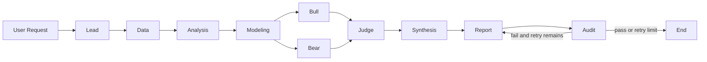

# Architecture

## Design principle

The platform separates model reasoning from deterministic facts:

- Models plan, interpret evidence, debate scenarios and write narratives.
- Data providers acquire timestamped source material.
- Python operators calculate financial values.
- The provenance ledger connects every claim to data or calculations.
- The audit layer blocks or flags unsupported and inconsistent output.

This boundary makes a report inspectable and reproducible instead of treating an LLM response as the system of record.

## Core contracts

| Contract | Purpose |
|---|---|
| `ResearchRequest` | Normalized query, symbols, market, date and task type |
| `ResearchPlan` | Playbook, steps, dependencies and execution budget |
| `DataArtifact` | Provider, as-of date, publication time, payload and hash |
| `CalculationArtifact` | Versioned operator, inputs, assumptions, formula and result |
| `Claim` | Narrative or numeric statement with provenance references |
| `AuditFinding` | Pass, warning or failure produced by a deterministic check |
| `ResearchArtifact` | Structured report sections and referenced record IDs |

The current dictionary-based `AgentState` remains supported. `ResearchState` extends it with optional typed fields, and adapters translate the existing planner output into the new contracts.

## Agent topology

The audit loop is bounded. The workflow wrapper owns the attempt counter, so a model or role handler cannot accidentally create an infinite revision loop.

## Tool boundaries

`ToolAccessController` applies least privilege by role:

- Data may call `data.*` and `mcp.*` tools.
- Modeling may call approved `compute.*` operators.
- Analysis, debate, synthesis and report roles read existing provenance but do not fetch arbitrary data.
- Audit reads provenance and runs `audit.*` checks.
- Lead performs planning and has no direct data-tool permission.

The policy layer is implemented and tested. Existing legacy ReAct agents will be migrated to it incrementally.

## Data layer

`DataProviderRegistry` resolves providers by capability, honors an explicit preference order and falls back when a provider fails. Every successful fetch becomes a `DataArtifact`. A provider result with an `as_of` date later than the request is rejected.

`CallableDataProvider` adapts existing MCP tools as well as future yfinance, SEC EDGAR, FMP, Finnhub, retail-sentiment, news and FX clients without coupling the rest of the platform to a vendor SDK.

## Compute layer

Built-in operators are deterministic and versioned:

- `dcf`: explicit cash flows plus Gordon-growth terminal value.
- `multiples`: median peer multiple applied to a subject metric.
- `monte_carlo_dcf`: seeded scenario simulation with P10/P50/P90 output.

Each result records input references, assumptions, formula, result hash, unit and currency.

## Audit and provenance

The ledger rejects reusing one record ID with different content. JSONL storage provides a simple append-only run log.

The audit engine currently checks:

1. Publication date does not exceed the analysis date.
2. Stale data is surfaced as a warning.
3. Calculation input references exist.
4. Claim references exist.
5. Numeric claims match referenced calculation metrics within tolerance.
6. Report artifact references resolve.

## Migration status

| Area | Status |
|---|---|
| Typed contracts and legacy adapters | Implemented |
| Data provider registry and callable adapter | Implemented |
| DCF, multiples and Monte Carlo DCF | Implemented |
| Provenance ledger and audit engine | Implemented |
| Four versioned playbooks | Implemented |
| New role policy and research graph | Implemented, opt-in |
| Existing CLI carries typed request and plan | Implemented |
| Live yfinance/SEC/FMP/Finnhub adapters | Planned |
| Migrate legacy agents to enforced role policies | Planned |
| Claim extraction from generated Markdown | Planned |
| Persistent run database and UI | Planned |
